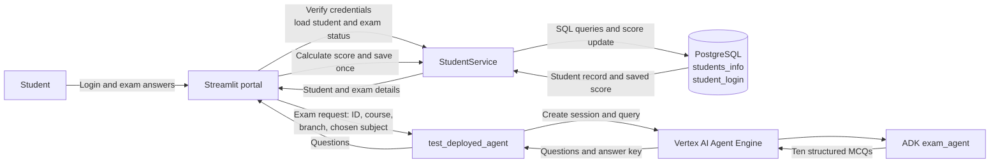

# Student Exam Portal and AI Exam Agent

A Streamlit portal for students to sign in, take a subject-specific multiple-choice
exam, and save their score to PostgreSQL. Exam questions are generated by a deployed
Google ADK agent hosted on Vertex AI Agent Engine.

## Architecture



## How it works

1. A student signs in with their ID card number and password.
2. The portal verifies the credentials against `students_info` and `student_login`.
   Inactive login records are rejected.
3. If the student has already written the exam (`written_exam = 1`), the portal blocks
   another attempt and displays the saved score.
4. Otherwise, the portal displays the student's `chosen_subject`.
5. On **Start Exam**, the portal retrieves the student's current exam details and sends
   `student_id`, `student_course`, `student_branch`, and `chosen_subject` to the deployed
   agent.
6. The student answers the generated questions and submits the exam. The portal scores
   the answers and stores the result in `students_info.exam_score`, setting
   `written_exam = 1`. The update only succeeds for a student whose exam has not already
   been marked as written.
7. The result page shows the score and a review of the questions and answers.

## Project files

- `streamlit_app.py` — Streamlit login, exam, and results interface.
- `students_service.py` — PostgreSQL queries for student login, exam details, and score
  updates.
- `test_deployed.py` — Creates a Reasoning Engine session and sends a request to the
  deployed agent.
- `exam_agent/agent.py` — Main ADK agent. It accepts a typed exam request and returns
  exactly ten structured MCQs, including answer choices, correct options, and
  explanations.
- `demo_exam_agent/agent.py` — Alternative plain-text agent example; it is not the
  structured response contract used by the Streamlit portal.
- `exam_agent/requirements.txt` — Dependencies for developing and deploying the ADK
  exam agent.
- `requirements.txt` — Dependencies for the Streamlit portal container.
- `Dockerfile` — Container image and Streamlit launch command.
- `steps.txt` — Database setup SQL and development/deployment notes.
- `.env.example` — Template for local and deployment environment variables.

## Requirements

- Python 3.13 for the supplied container image; use Python 3.13 locally as well.
- PostgreSQL with the tables described in `steps.txt`.
- Google Cloud project with Vertex AI / Agent Engine configured and an agent deployed.
- Application Default Credentials for local development and a Cloud Run service account
  with permission to call the deployed Reasoning Engine.
- Google Cloud CLI and the ADK CLI for agent deployment; Docker for container builds.
- Network access from the portal to the PostgreSQL instance and Google APIs.

## Configuration

Copy `.env.example` to `.env` for local development and replace every placeholder.
`streamlit_app.py` and `students_service.py` load this file through `python-dotenv`.
The deployed Reasoning Engine client uses Application Default Credentials; for local
development, authenticate with:

```bash
gcloud auth application-default login
```

Configure these variables in `.env` locally and in the Cloud Run environment:

| Variable | Purpose | Default |
| --- | --- | --- |
| `DB_USER` | PostgreSQL user | `postgres` |
| `DB_PASSWORD` | PostgreSQL password | None |
| `DB_HOST` | PostgreSQL host | `localhost` |
| `DB_PORT` | PostgreSQL port | `5432` |
| `DB_NAME` | PostgreSQL database | `postgres` |
| `PROJECT_ID` | Google Cloud project that contains the deployed Reasoning Engine | Must be configured |
| `LOCATION` | Vertex AI region | `asia-south1` |
| `REASONING_ENGINE_ID` | Deployed Agent Engine resource ID | Empty; must be configured |
| `GOOGLE_GENAI_USE_ENTERPRISE` | Use Google Cloud enterprise GenAI services | `1` in `.env.example` |
| `GOOGLE_CLOUD_PROJECT` | Google Cloud project used by Google GenAI libraries | Must be configured |
| `GOOGLE_CLOUD_LOCATION` | Google GenAI service location | Must be configured |
| `PORT` | HTTP port used by the container | `8080` |

Do not commit `.env` files, database credentials, service-account keys, or access
tokens. In a container, `DB_HOST=localhost` refers to the container itself; use a
reachable PostgreSQL hostname or address instead.

The deployed-agent client refreshes Application Default Credentials and uses the
resulting access token as a bearer token in its request. It therefore needs no
hard-coded access token in the source.

On Cloud Run, grant the service's runtime service account the `roles/aiplatform.user`
role in the project that contains the Reasoning Engine. Replace the project and
service-account values with your own:

```bash
gcloud projects add-iam-policy-binding YOUR_PROJECT_ID \
  --member="serviceAccount:YOUR_CLOUD_RUN_SERVICE_ACCOUNT" \
  --role="roles/aiplatform.user"
```

For Cloud Run, `--env-vars-file` requires YAML or JSON, not standard `.env` syntax.
Create a local `.env.yaml` with the same variable names and YAML key/value pairs, and
keep it out of source control. For production, store sensitive values such as
`DB_PASSWORD` in Secret Manager rather than a plain environment file.

## Database

The portal expects these tables (see `steps.txt` for the full setup SQL and example
seed data):

- `students_info`: student identity, course, branch, `chosen_subject`, `written_exam`,
  and `exam_score`.
- `student_login`: student ID, password, and `is_active` flag.

The ID card number is stored in `students_info.id_card_no`. Login records link to
students using `student_login.student_id`. Password storage in the sample SQL is
plaintext and intended only for local testing. For real deployments, store salted,
strong password hashes and verify them in application code; never store or display
plaintext passwords.

## Run locally

From the repository root, create a virtual environment, install the portal dependencies,
and start Streamlit:

```bash
python3 -m venv .venv
source .venv/bin/activate
python -m pip install -r requirements.txt
cp .env.example .env
# Edit .env and replace its placeholder values before continuing.
streamlit run streamlit_app.py
```

The portal opens on port `8501` by default when run directly with Streamlit.

To run the structured agent locally, install its ADK dependency and launch it from the
repository root:

```bash
python -m pip install -r exam_agent/requirements.txt
adk run exam_agent
```

The local agent accepts input in this shape:

```json
{
  "student_id": 1,
  "student_course": "B.Tech",
  "student_branch": "CSE",
  "chosen_subject": "Machine Learning"
}
```

## Deploy the agent

From the repository root, deploy the structured agent with the ADK CLI:

```bash
adk deploy agent_engine \
  --project=YOUR_PROJECT_ID \
  --region=YOUR_REGION \
  --display_name=exam_agent \
  exam_agent
```

Set `PROJECT_ID`, `LOCATION`, and the deployed `REASONING_ENGINE_ID` in the portal's
runtime environment. Set `GOOGLE_CLOUD_PROJECT` and `GOOGLE_CLOUD_LOCATION` as well.
The project and region must match where the Reasoning Engine was deployed. The deployed
resource ID is available from the deployment output or Google Cloud. Ensure the Cloud
Run runtime service account has the `roles/aiplatform.user` role on that project.

## Build and run the Streamlit container

Build from the repository root; the root `Dockerfile` uses the root requirements file:

```bash
docker build \
  -t student-exam-portal \
  -f Dockerfile \
  .
```

Run the container with its configuration supplied at runtime. Create `.env` from
`.env.example` and fill in valid values first:

```bash
docker run --rm -p 8080:8080 \
  --env-file .env \
  -e PORT=8080 \
  student-exam-portal
```

The container listens on `0.0.0.0` and uses `PORT` (default `8080`). The app files and
dependencies are copied into the image; `.env` should be provided at runtime and should
not be copied into the image.

To push the image to Artifact Registry and deploy it to Cloud Run, replace the example
project, region, repository, and image tag with your own:

```bash
docker buildx build \
  --platform linux/amd64 \
  -f Dockerfile \
  -t REGION-docker.pkg.dev/PROJECT_ID/REPOSITORY/student-exam-portal:v1 \
  --push .

gcloud run deploy students-exam-agent \
  --image=REGION-docker.pkg.dev/PROJECT_ID/REPOSITORY/student-exam-portal:v1 \
  --project=PROJECT_ID \
  --region=REGION \
  --port=8080 \
  --allow-unauthenticated \
  --env-vars-file=.env.yaml
```

Create `.env.yaml` in YAML or JSON format from the values in `.env.example`; do not
pass the standard `KEY=value` `.env` file to `--env-vars-file`. Keep `.env.yaml`
private, and use Secret Manager for production secrets.

## Exam and data notes

- The structured agent returns ten questions with four options (`A`-`D`), a correct
  option, and an explanation.
- `student_id` is sent as an identifier; course, branch, and chosen subject guide
  question generation.
- The database update guards against a second submission, but question generation and
  exam state are held in the Streamlit session. This project does not currently
  implement a persistent exam-attempt record or a timer.
- The result review displays correct options and explanations after submission. Do not
  expose the answer key before submission in a production exam workflow.
- Do not use the example student records or passwords from `steps.txt` as production
  credentials.

Project done by:
Malkapurapu Sivamanikanta
malkapurapusivamanikanta@gmail.com
+91 8919369694
